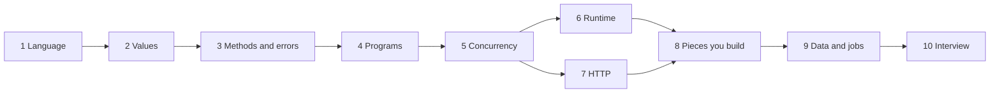

# Go, level by level

Learn in order. Finish a level’s exit checklist before you open the next file. Each level is notes you can study, then a small amount of code you type yourself.

These notes start at the language and end at the interview. They are built from:

- `golang-interview-notes.md` — the spoken answers and the code interviewers ask you to write
- `interview-months/` — the six-month build order
- `interview-prep` — the original 90-day project plan

The language version assumed here is **Go 1.22 or newer**. A few answers changed later. The notes name the version when that happens. The source notes treat the current language as **Go 1.27**.

## How to use a level

1. Read the level once, slowly. Draw the diagrams on paper if the mermaid picture is new.
2. Type every code block into a throwaway module (`go mod init example.com/levelN`). Run it. Change one line and see what breaks.
3. Do the practice at the bottom. Do not copy a solution from the notes into the practice.
4. When the exit checklist is true, go to the next level.

Weekday shape, once you are past level 1: 30 minutes reading the level, 2 hours writing, 30 minutes on `go test`, `go test -race` when the level mentions races, and a commit.

## The path

| Level | File | You can explain | You can write |
| --- | --- | --- | --- |
| 1 | [level-01-language.md](level-01-language.md) | Packages, zero values, `for`, functions, `defer` | A small `main` that parses input and returns errors |
| 2 | [level-02-values.md](level-02-values.md) | Slice header, map rules, struct size, strings | Append, lookup, and JSON without the usual leaks |
| 3 | [level-03-methods-and-errors.md](level-03-methods-and-errors.md) | Method sets, interface words, typed nil, `errors.Is` | A small type with constructors and wrapped errors |
| 4 | [level-04-programs.md](level-04-programs.md) | Modules, `internal`, table tests, `io.Reader` | A tested package with a fuzz test |
| 5 | [level-05-concurrency.md](level-05-concurrency.md) | Races, mutex, channel, `select`, cancel | A bounded worker pool that shuts down |
| 6 | [level-06-runtime.md](level-06-runtime.md) | Escape analysis, GMP, the collector, map internals | A profile of one hot function, and a sharded map |
| 7 | [level-07-http.md](level-07-http.md) | Server timeouts, the client pool, shutdown | An HTTP API with health checks and graceful stop |
| 8 | [level-08-pieces.md](level-08-pieces.md) | The timed problems and why each one deadlocks | Pool, crawler, transfer, cache, LRU, limiter |
| 9 | [level-09-data.md](level-09-data.md) | SQL pool, `SKIP LOCKED`, outbox, idempotency | A job claim query and a short transaction |
| 10 | [level-10-interview.md](level-10-interview.md) | Four designs, pprof, the bug list, the six sentences | A 15-minute design spoken without the page |

Levels 6 and 7 can overlap after level 5. Level 8 needs both.

## After level 10, build the systems

The notes teach the ideas. The months make them yours. Start `interview-months/` only after level 5 feels ordinary, and start month 3 only after level 8.

| Month | File | Project | Levels it uses |
| --- | --- | --- | --- |
| 1 | `interview-months/month-01-syntax-and-fundamentals.md` | `foundation`: ledger, HTTP API, worker pool | 1–5, 7 |
| 2 | `interview-months/month-02-interview-projects.md` | cache, LRU, limiter, breaker, crawler, pub/sub | 5, 8 |
| 3 | `interview-months/month-03-persistent-kv.md` | `gokv`: sharded log-structured store | 6, 8 |
| 4 | `interview-months/month-04-distributed-jobs.md` | `chronos-q`: delayed jobs | 6, 9 |
| 5 | `interview-months/month-05-gateway.md` | `pulse-gateway`: proxy and limiter | 7, 8, 10 |
| 6 | `interview-months/month-06-interview-execution.md` | timed redos and system design | 10 |

## Official references

Keep these open while you study. The notes point at the page that matches the section.

- [A Tour of Go](https://go.dev/tour/)
- [Effective Go](https://go.dev/doc/effective_go)
- [Go language specification](https://go.dev/ref/spec)
- [Standard library](https://pkg.go.dev/std)
- [Go by example](https://gobyexample.com/)
- [Diagnostics](https://go.dev/doc/diagnostics)
- [Garbage collector guide](https://go.dev/doc/gc-guide)
- [Memory model](https://go.dev/ref/mem)
- [Release notes](https://go.dev/doc/devel/release) — check the version your `go.mod` line names
