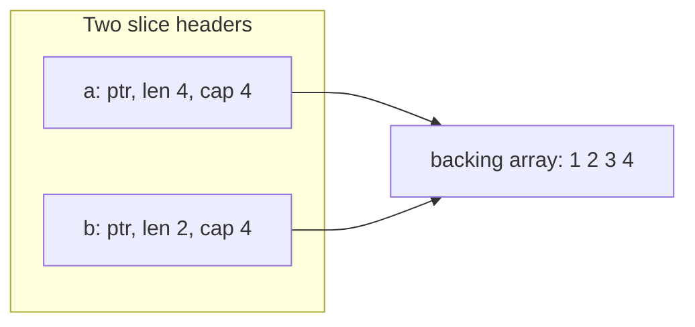

# Level 2 — Values, slices, maps, structs

Go passes everything by value. Sometimes that value is a small header, so the copy is cheap and the data behind it is shared. That sentence is the rest of this level.

Official pages: [Go slices](https://go.dev/blog/slices-intro), [Go maps in action](https://go.dev/blog/maps), [Strings, bytes, runes](https://go.dev/blog/strings).

## 1. What a copy actually copies

| You copy | What is duplicated | What is shared |
| --- | --- | --- |
| `int`, `bool`, struct of those | the bits | nothing |
| `string` | pointer and length (16 bytes on 64-bit) | the immutable bytes |
| slice | pointer, length, capacity (24 bytes) | the backing array |
| map | the pointer to the runtime map | the buckets |
| channel | the pointer to the runtime channel | the channel |
| pointer | the address | the object it points at |



`new(T)` returns `*T` pointing at a zero `T`. `make` is only for slice, map, and channel. It returns the type already initialized, not a pointer to it.

```go
p := new(int)           // *int, value 0
s := make([]int, 0, 8)  // len 0, cap 8
m := make(map[string]int)
```

## 2. Slices

A slice variable is three words: a pointer to an array, a length, and a capacity.

`append` writes into the existing array when `len + n <= cap`. It allocates a new array when the new length would pass the capacity, copies the old elements, and returns a header aimed at the new array. The caller’s variable changes only if you assign the result.

```go
s = append(s, x)
```

Growth, since Go 1.18. If the needed length is already more than twice the old capacity, the new capacity is the needed length. Otherwise, below 256, capacity doubles. At 256 and above it grows by about a quarter: add `(cap + 3*256) / 4` until it fits. The allocator then rounds the byte size up to a size class, so the `cap` you see can be a little larger than the formula.

### Aliasing

```go
a := []int{1, 2, 3, 4}
b := a[:2]        // len 2, cap 4, same array
b = append(b, 9)  // writes a[2], a is now 1 2 9 4
```

`b` still had room in `a`. The three-index form cuts the capacity:

```go
b = a[:2:2] // len 2, cap 2, next append allocates
```

`slices.Clone` copies into a new array. `slices.Clip` sets cap equal to len. Clip stops the overwrite. It does not free the tail of a large array, because the header still points into that array.

### The leak

A 10-byte view of a 10 MB buffer keeps the 10 MB alive for the collector, as long as any header still points into that array. Copy the 10 bytes out.

```go
func firstN(buf []byte, n int) []byte {
    out := make([]byte, n)
    copy(out, buf[:n])
    return out
}
```

`strings.Clone` is the same fix for a small substring of a large string.

### Length and capacity you mean

`make([]T, n)` has length n, filled with zero values. A later `append` goes after those zeros. `make([]T, 0, n)` has length 0 and room for n appends. Use the second form when you are about to fill the slice yourself.

`copy(dst, src)` copies `min(len(dst), len(src))` elements. It does not grow `dst`. Overlap is safe.

Ranging a slice copies each element into the loop variable. `v.Done = true` changes the copy. Write `items[i].Done = true`, or store pointers. The range expression is evaluated once. Appending during the loop does not add iterations.

From Go 1.22, each iteration has its own loop variable. Before 1.22, the loop used one variable, so a goroutine started in the loop saw the last value. Passing the value as a parameter is still the clear form:

```go
for _, item := range items {
    go func(it Item) {
        it.Work()
    }(item)
}
```

### nil and empty

A nil slice and an empty slice both have length 0. `append` and `range` treat them the same. `encoding/json` does not, for `encoding/json` (v1 behavior): a nil slice encodes as `null`, a non-nil empty slice encodes as `[]`. Return `[]T{}` when the client will range on the JSON.

Check emptiness with `len(s) == 0`. That is true for both.

On Go 1.27, `encoding/json/v2` marshals a nil slice as `[]`. Say which package you imported before you describe a nil slice.

## 3. Maps

Language rules, all of them:

- A nil map reads as the zero value and reports `ok == false`. Writing it panics. `len` of nil is 0. `range` over nil does nothing. `delete` on nil does nothing.
- `v, ok := m[k]` tells a missing key from a stored zero.
- Keys must be comparable: numbers, strings, booleans, pointers, channels, interfaces, and arrays or structs of those. Slices, maps, and functions cannot be keys.
- Assignment and range copy the key and the value. A large struct value is copied on every lookup. Store a pointer when the value is big and you have measured it.
- You cannot take the address of `m[k]`. Growth can move the slot.
- Range order is unspecified. Do not depend on insertion order.
- A key inserted during a range may be visited or skipped. A key deleted during a range is not visited later.
- Concurrent read and write kills the process: `fatal error: concurrent map read and map write`. Two writers: `fatal error: concurrent map writes`. Neither is a panic. `recover` does not catch it. Concurrent reads alone are fine.
- `clear(m)` removes every entry. Do not expect the map to shrink.

```go
age := map[string]int{
    "ada": 36,
}
n, ok := age["grace"] // 0, false
age["grace"] = 45
delete(age, "ada")
```

Make the map before the first write. A map field on a struct is nil until you assign `make` or a composite literal.

How the runtime stores entries changed in Go 1.24 (Swiss tables). Level 6 covers that. The rules in this section did not change.

## 4. Structs and pointers

```go
type Money struct {
    Paise    int64
    Currency string
}

func NewMoney(paise int64, currency string) (Money, error) {
    if currency == "" || paise < 0 {
        return Money{}, fmt.Errorf("bad money")
    }
    return Money{Paise: paise, Currency: currency}, nil
}
```

The zero `Money` is `{0, ""}`. A constructor is how you stop the rest of the program from treating that as a real amount.

`&m` is a pointer. `p.Paise` works on a pointer. Go dereferences it. There is no `->`.

A pointer is nil until you set it. Reading a field through a nil pointer panics.

### Field alignment

Each field is placed at a multiple of its own alignment. The struct’s size is rounded up to the alignment of its widest field.

```go
type Loose struct { // 24 bytes on amd64
    A bool
    N int64
    B bool
}

type Tight struct { // 16 bytes on amd64
    N int64
    A bool
    B bool
}
```

Reorder a hot struct you have measured. Leave a public struct readable until a profile says the padding matters. `unsafe.Sizeof` is the check.

Two goroutines writing neighboring fields can still bounce one cache line, usually 64 bytes, even with no logical race. That is false sharing. Level 6 is where you pad or split counters. For now, know the name.

## 5. Strings and runes

A string is immutable bytes, usually UTF-8. `len(s)` is bytes. `s[i]` is one byte. `for i, r := range s` yields a rune and the byte offset of that rune.

Slicing at an arbitrary index can cut a rune in half. Range the string, or convert to `[]rune`, when the unit is a character. `[]byte(s)` and `string(b)` each copy. `utf8.RuneCountInString` is the character count.

```go
s := "हेलो"
fmt.Println(len(s))                    // bytes, not 4
fmt.Println(utf8.RuneCountInString(s)) // 4
for i, r := range s {
    fmt.Printf("%d %c\n", i, r)
}
```

## 6. Worked example: a tiny ledger index

```go
type Account struct {
    ID   string
    Name string
}

type Index struct {
    byID map[string]*Account
}

func NewIndex() *Index {
    return &Index{byID: make(map[string]*Account)}
}

func (x *Index) Put(a Account) {
    x.byID[a.ID] = &a // BUG: &a is the loop/parameter slot, see below
}
```

`a` is the function parameter. `&a` is stable for this call, so this particular `Put` is fine: each call has its own `a`, and the pointer escapes to the heap (level 6). The bug appears when people take `&a` on a range variable they expected to be per-element in old compilers, or when they store `&m[k]`, which does not compile.

The version to type:

```go
func (x *Index) Add(id, name string) {
    x.byID[id] = &Account{ID: id, Name: name}
}

func (x *Index) Get(id string) (Account, bool) {
    a, ok := x.byID[id]
    if !ok {
        return Account{}, false
    }
    return *a, true // copy out, caller cannot mutate the stored account
}
```

Returning `*a` shares the stored account. Return a copy unless the caller is supposed to share it.

## Practice

1. Print `len` and `cap` after each `append` of one `int`, starting from a nil slice, until length 20. Write down where the capacity jumped.
2. Show the aliasing bug: a subslice `append` overwrites the parent. Fix it with the three-index slice, then again with `slices.Clone`.
3. Take 8 bytes from a 1 MB buffer. Keep one version that retains the large array and one that `copy`s. You will prove the leak with a heap profile in level 6. For now, write both functions and a comment that says which header still points at the big array.
4. A map from word to count. Use `v, ok`. Delete a word. Range and print, and write in a comment that order is not part of the result.
5. Build `Loose` and `Tight` and print `unsafe.Sizeof` of each.

## Exit checklist

- You can draw a slice header and say what `append` does when capacity remains.
- You can say why a small slice of a large array keeps the large array alive.
- You know a nil map read returns the zero value, and a nil map write panics.
- You use `v, ok` to tell a missing key from a stored zero.
- You can explain nil slice JSON `null` versus empty slice `[]` for `encoding/json`.

Next: [level-03-methods-and-errors.md](level-03-methods-and-errors.md).
