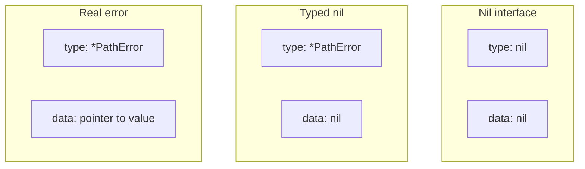

# Level 3 — Methods, interfaces, errors

You can attach behavior to a type, hide that type behind a small interface, and return errors that a caller can branch on.

Official pages: [Effective Go: methods and interfaces](https://go.dev/doc/effective_go#methods), [errors](https://go.dev/doc/effective_go#errors), [Working with Errors in Go 1.13](https://go.dev/blog/go1.13-errors), [`errors` package](https://pkg.go.dev/errors).

## 1. Methods and method sets

A method is a function with a receiver. The receiver is the value the method sees.

```go
type Money struct {
    Paise    int64
    Currency string
}

func (m Money) String() string {
    return fmt.Sprintf("%s %d", m.Currency, m.Paise)
}

func (m *Money) Debit(n int64) error {
    if n < 0 || m.Paise < n {
        return fmt.Errorf("cannot debit %d from %d", n, m.Paise)
    }
    m.Paise -= n
    return nil
}
```

- A value receiver sees a copy. The method is in the method set of `T` and of `*T`.
- A pointer receiver sees the original. The method is only in the method set of `*T`.
- If any method needs a pointer, make every method on that type a pointer method. Mixing them is how a value fails to implement an interface.

A variable is addressable, so `m.Debit(n)` compiles for a `Money` variable: the compiler takes the address. A map element is not addressable. `accounts[id].Debit(n)` does not compile when the map holds `Money` values. Copy the element out, change it, store it back. Or store `*Money`.

## 2. Embedding

Embedding puts a field’s fields and methods on the outer type. The receiver of a promoted method is still the inner value. An outer method of the same name hides the inner one.

```go
type Store struct {
    mu sync.Mutex // named field
    m  map[string]int
}
```

Keep a `sync.Mutex` as a named field. Embedding it promotes `Lock` and `Unlock` onto your public API, so any caller can lock your store.

Do not copy a value that contains a mutex, a `WaitGroup`, a `Cond`, or a `Pool`. The copy has a different lock. The original’s waiters are not in it. `go vet` reports `copylocks`. Pass a pointer.

## 3. Interfaces are two words

An interface value is a pair.

- For a named interface, the first word is an itab: the concrete type, the interface type, and the method pointers.
- For `any`, the first word is the type descriptor.
- The second word is a pointer to the data. A value that is not already a pointer is boxed: the runtime copies it, and that copy usually escapes to the heap.



The interface is nil only when both words are nil. A nil pointer stored in an interface has a type, so `err != nil` is true.

```go
func load(failed bool) error {
    var pe *os.PathError
    if failed {
        return &os.PathError{Op: "open", Path: "a", Err: fs.ErrNotExist}
    }
    return pe  // typed nil: err != nil, and calling a method can panic
}

func loadFixed(failed bool) error {
    if failed {
        return &os.PathError{Op: "open", Path: "a", Err: fs.ErrNotExist}
    }
    return nil // both words nil
}
```

Return a bare `nil`. Do not return a nil pointer of a concrete error type as `error`.

A type assert `v, ok := x.(T)` is the safe form. Without `ok` it panics on the wrong type. A type switch is `switch v := x.(type)`.

Comparing two interfaces compares the dynamic types and then the values. If the dynamic type is a slice, a map, or a function, the comparison panics.

### Accept interfaces, return concrete types

A parameter is an interface when the function uses a small behavior: `io.Reader`, `io.Writer`, `context.Context`, `error`. Declare that interface next to the code that consumes it, when a second implementation exists. A test fake counts.

Return the struct, so you can add a field without breaking callers who stored the result. `any` says nothing. Use it where the value is genuinely untyped.

Small integers are interned by the runtime, so boxing a tiny integer often does not allocate. Putting a larger concrete value into `any`, or printing it with `fmt`, shows up in allocation profiles. Level 6 is the measurement. The habit now: keep the concrete type on a hot path.

## 4. Errors

`error` is an interface with one method: `Error() string`.

```go
var ErrNotFound = errors.New("not found")
var ErrMismatch = errors.New("currency mismatch")

func Transfer(from, to Money, n int64) (Money, Money, error) {
    if from.Currency != to.Currency {
        return from, to, ErrMismatch
    }
    if from.Paise < n {
        return from, to, fmt.Errorf("transfer %d: %w", n, ErrNotFound)
    }
    from.Paise -= n
    to.Paise += n
    return from, to, nil
}
```

Wrap with `fmt.Errorf("load %s: %w", id, err)` when the caller is allowed to see the cause. Use `%v` when the cause is an internal detail and the caller should branch on your error instead.

- `errors.Is` walks the unwrap chain for a sentinel.
- `errors.As` fills a pointer to the concrete type you hope to find.
- `errors.Join` builds one error that unwraps to several, and it drops nil arguments.

```go
if errors.Is(err, fs.ErrNotExist) {
    return ErrNotFound
}
var pe *os.PathError
if errors.As(err, &pe) {
    log.Print(pe.Path)
}
```

Export a sentinel when callers must branch. Document it. `var ErrNotFound = errors.New("not found")` at package level.

`context.Canceled` and `context.DeadlineExceeded` are ordinary errors. A cancelled request is often a successful early return. Do not treat it as an upstream failure. Level 5 and level 7 use that rule.

A `defer` can wrap the error by assigning a named result. Named results are assigned by `return` before defers run.

```go
func read(path string) (err error) {
    f, err := os.Open(path)
    if err != nil {
        return err
    }
    defer func() {
        if cerr := f.Close(); cerr != nil && err == nil {
            err = cerr
        }
    }()
    // read f
    return nil
}
```

The `:=` trap: inside an `if` block, `err := fn()` creates a new `err`. The outer `err` stays nil. Use `=` when the outer name should change.

## 5. panic and recover

`panic` unwinds the goroutine. Library code returns an error. Panic is for a broken program, or for `MustCompile` of a fixed pattern at init.

`recover` returns the panic value only when it is called directly from a deferred function in the same goroutine. A helper that calls `recover` catches nothing. A new goroutine that calls `recover` catches nothing of the parent.

`net/http` recovers a panic in a handler and keeps the process up. A panic in a goroutine you started yourself has no such recover and crashes the process. At a boundary you own, recover, log `debug.Stack()`, turn it into an error, and then fix the panic. Recover is not a control-flow device.

## 6. io.Reader, because errors come with bytes

`io.Reader.Read` may return `n > 0` together with an error, including `io.EOF`. Process the bytes, then the error. `io.Copy` and `io.ReadAll` already do. `io.EOF` from `Read` means no more bytes. `io.Copy` treats that as success and returns a nil error.

## 7. Functional options, a small pattern

When a constructor grows past two or three knobs, options are functions that edit an unexported config.

```go
type option func(*config)

type config struct {
    sync bool
}

func WithSync(on bool) option {
    return func(c *config) { c.sync = on }
}

func Open(dir string, opts ...option) (*DB, error) {
    cfg := config{}
    for _, opt := range opts {
        opt(&cfg)
    }
    return open(dir, cfg)
}
```

Use this when callers should ignore knobs they do not care about. A struct parameter is clearer when every call sets every field.

## Practice

1. `Money` with `Add` (value receiver, returns a new `Money` and an error on currency mismatch or overflow) and `Debit` (pointer receiver, error if the result would be negative). Test mismatch, overflow, negative debit, and success.
2. Write the typed-nil test: `var err error = (*os.PathError)(nil)` is not equal to `nil`. Write one sentence on why, in a comment.
3. An interface `Store` with `Get(id string) (Account, error)`. An in-memory implementation. `Get` of a missing id returns `ErrNotFound`. A caller uses `errors.Is`.
4. A function that returns a typed nil by accident, and the fixed version next to it.

## Exit checklist

- You can say which method set a value receiver and a pointer receiver belong to.
- You can draw the two words of an interface and explain a typed nil.
- You wrap with `%w` and branch with `errors.Is` and `errors.As`.
- You return errors from library code. Panic is reserved for a broken program.
- You do not copy a struct that contains a mutex.

Next: [level-04-programs.md](level-04-programs.md).
