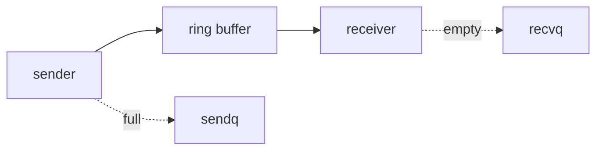

# Level 5 — Concurrency

You can start goroutines, share memory safely, hand a value across a channel, and stop the work when the caller cancels.

Two tools, two jobs. A channel hands ownership from one goroutine to another. After you send, you stop touching that value unless the design says the receiver is done with it. A mutex protects a value both sides keep using.

Official pages: [Share memory by communicating](https://go.dev/blog/codelab-share), [Memory model](https://go.dev/ref/mem), [Race detector](https://go.dev/doc/articles/race_detector), [context](https://pkg.go.dev/context), [Concurrency in Go](https://go.dev/blog/waza-talk) (talk, optional).

## 1. A goroutine and a race

The `go` statement runs a function concurrently. The `go` statement happens before the new goroutine starts. Writes before `go` are visible inside it.

```go
go func() {
    fmt.Println("beside main")
}()
```

A data race: two goroutines access the same variable, at least one writes, and nothing establishes a happens-before edge. The compiler may reorder a race, tear it, or delete it. The behavior is undefined.

```bash
go test -race ./...
```

The detector reports a race only if both accesses actually run. A clean race test is evidence about the paths you ran. It costs several times the CPU and the memory. Run it in CI. Leave it off in production.

`go test -race` on a test that never overlaps the two calls will stay green while production panics. The test has to run the goroutines together.

## 2. Mutex, WaitGroup, Once

`sync.Mutex` zero value is unlocked. Do not copy it. Lock, change the fields that belong together, unlock.

```go
type Ledger struct {
    mu sync.Mutex
    bal map[string]int64
}

func (l *Ledger) Add(id string, n int64) {
    l.mu.Lock()
    defer l.mu.Unlock()
    l.bal[id] += n
}
```

`defer Unlock` on the next line when the critical section is the rest of the function. When the critical section is three lines in a longer function, unlock on the line after it so you do not hold the lock across the call that follows. Never hold a mutex across a network call, a channel send that might block, or `Wait` on something the lock’s owner is involved in.

`RWMutex` allows many readers or one writer. A waiting writer blocks new readers, so a continuous stream of readers cannot starve the writer. Readers already inside finish. It pays off when the critical section is more than a few instructions and reads dominate. Do not `RLock` twice on the same goroutine while a writer might be waiting: the second `RLock` blocks, the writer waits for the first, and you deadlock. `Lock` inside `RLock` on the same goroutine is the same deadlock.

`WaitGroup`. `Add` before `go`. `defer Done` inside. `Wait` blocks until the counter is zero. `Add` from inside the new goroutine races with `Wait`: `Wait` can observe zero before the `Add` runs. A negative counter panics. `wg.Go(fn)` in Go 1.25 does the `Add`, the start, and the `Done` together. A panic in `fn` still crashes the process.

`sync.Once`. `Do(f)` runs `f` once. A panic inside `f` counts as done. Later callers do not retry. `OnceFunc` and `OnceValue`, since Go 1.21, share one execution and one result, including one panic, with the callers who showed up while it ran.

### Fairness, in one paragraph

Normal mode lets a new arrival steal the lock. Waiters are queued, but a woken waiter competes with new arrivals, and a new arrival is already running, so it often wins. If a waiter has been failing to acquire for about 1 ms, the mutex switches to starvation mode and the unlocking goroutine hands the lock to the head of the queue. New arrivals join the tail. The mutex returns to normal mode when the waiter that received the lock sees that it waited less than 1 ms, or that it is the last waiter. Starvation mode bounds the wait. It does not make a hot lock cheap. The fix for a hot lock is a shorter critical section, or a shard (level 6).

## 3. Channels

The runtime structure is `hchan`: a lock, a count, a capacity, a ring buffer, a closed flag, and two wait queues (`sendq`, `recvq`). A waiter is a `sudog`.



- Unbuffered: the sender parks until a receiver arrives, or the receiver parks until a sender arrives. The value is copied straight to the receiver. That rendezvous is a happens-before edge.
- Buffered: the value goes into the ring if there is room and nobody is waiting. If a receiver is already waiting, the sender hands the value to that receiver directly.
- A send on a full buffer parks. A receive on an empty buffer parks. Closing wakes the waiters.

Close rules:

- The sender closes. Closing says “no further value is coming”.
- Close of a closed channel panics. Close of a nil channel panics. A send on a closed channel panics.
- A receive on a closed channel returns the zero value and `ok == false`, immediately.
- `for v := range ch` receives until close. A range over a channel nobody closes blocks until the process ends.
- With several senders, one owner closes, after the others have finished. A `WaitGroup` plus a single `close` is the usual shape.

Nil channel rules, which are a tool:

- Send and receive on a nil channel block forever.
- A `select` case whose channel is nil is never chosen. Set the variable to nil to turn that case off.

`select` waits until one case can run. If several can, it picks pseudo-randomly. Case order is not priority. A `default` returns instead of waiting. An empty `select {}` blocks forever.

```go
func merge(ctx context.Context, a, b <-chan int) <-chan int {
    out := make(chan int)
    go func() {
        defer close(out)
        for a != nil || b != nil {
            select {
            case <-ctx.Done():
                return
            case v, ok := <-a:
                if !ok {
                    a = nil
                    continue
                }
                select {
                case <-ctx.Done():
                    return
                case out <- v:
                }
            case v, ok := <-b:
                if !ok {
                    b = nil
                    continue
                }
                select {
                case <-ctx.Done():
                    return
                case out <- v:
                }
            }
        }
    }()
    return out
}
```

A send that ignores cancel leaks the goroutine when the consumer is slow and the caller has cancelled. The inner `select` is that fix.

Happens-before, the edges you can name:

- A send happens before the receive of that value completes.
- A close happens before a receive that observes the close.
- On an unbuffered channel, the receive happens before the send completes.
- The nth `Unlock` happens before a later `Lock` on the same mutex returns.
- The call inside `sync.Once.Do` happens before any `Do` on that Once returns.
- An atomic store happens before the atomic load that observes that value. A plain `bool` flag, written with no atomic and no mutex, does not give you this.

## 4. Context

`context.Context` is the first parameter, named `ctx`. It carries a deadline, a cancellation signal, and, sparingly, request-scoped values. A nil `Context` is a bug. `context.Background()` is the root in `main`. `context.TODO()` marks a call site that should grow a real context later.

`WithCancel` returns a child and a `cancel` function. `defer cancel()` so the parent’s timer and the child’s waiters go away when this function returns. `WithTimeout` and `WithDeadline` cancel at the time or when the parent cancels, whichever is first. `ctx.Done()` is closed when the context is done. `ctx.Err()` is then `context.Canceled` or `context.DeadlineExceeded`.

Cancellation flows down. A child does not cancel its parent. The goroutine must select on `ctx.Done()` at every wait. A compute loop that never looks at the context runs until it finishes.

`WithValue` is for data that crosses an API boundary and has no better parameter: a request id. The key is an unexported type. Options, user ids, and database handles are parameters. Do not store a `Context` in a long-lived struct.

`context.WithoutCancel`, since Go 1.21, keeps the values and drops the cancellation. Use it for a piece that must finish after the client has gone, such as an audit write you already decided to do.

`context.AfterFunc`, since Go 1.21, runs a function in its own goroutine when the context is cancelled.

## 5. The worker pool

Talk before you type. The pool is fixed. The producer owns `jobs` and closes it. Workers leave on close or on cancel. `Add` happens before `go`.

```go
func Run(ctx context.Context, n int, jobs <-chan Job) {
    var wg sync.WaitGroup
    wg.Add(n)
    for range n { // Go 1.22. Older: for i := 0; i < n; i++
        go func() {
            defer wg.Done()
            for {
                select {
                case <-ctx.Done():
                    return
                case j, ok := <-jobs:
                    if !ok {
                        return
                    }
                    j.Do(ctx)
                }
            }
        }()
    }
    wg.Wait()
}
```

The `select` notices cancel while the worker is waiting for a job. If `Do` must stop promptly, `Do` has to watch `ctx` too.

Bounded concurrency is also a channel of capacity n, used as a semaphore: send before the work, receive after. Prefer `errgroup.SetLimit` when you also need the first error and cancellation.

## 6. errgroup and singleflight

`golang.org/x/sync/errgroup`. `WithContext` cancels the derived context when the first function returns an error, or when the parent is cancelled. `Wait` still waits for every function and returns the first error. The functions must observe `ctx.Done()`. errgroup does not recover a panic. A panic still kills the process.

`singleflight` (`golang.org/x/sync/singleflight`). `Do(key, fn)` runs `fn` once while a call for that key is in flight. Concurrent callers wait and receive the same result. When the call finishes, the key is forgotten. It does not cache. The next request after the stampede misses again, and that is what a cache is for. Do not count a `context.Canceled` inside `fn` as a cached failure for the other waiters. They did not cancel.

## 7. Timers in select

`time.After` in a loop allocates a timer every pass. Before a `go` line of 1.23, an unstopped timer lived until it fired. Keep one `Timer` and `Reset` it. After 1.23 the garbage collector can reclaim an unreferenced timer, and the allocation is still waste.

```go
timer := time.NewTimer(200 * time.Millisecond)
defer timer.Stop()

for {
    select {
    case <-ctx.Done():
        return ctx.Err()
    case v := <-ch:
        handle(v)
    case <-timer.C:
        flush()
        timer.Reset(200 * time.Millisecond)
    }
}
```

For a timer created with `NewTimer`, Go 1.23 and later guarantee that a receive from `t.C` after `Reset` or `Stop` has returned will not observe a time value from the previous setting. You can `Reset` after you have received from `t.C`. Before 1.23 the safe sequence was `Stop`, and if `Stop` returned false, drain `t.C`, then `Reset`. The old drain is still correct. It is required on a `go` line older than 1.23. Check `go doc time.Timer.Reset` for the version you compile with.

## 8. A leak

A goroutine blocked on a channel or a `sync` primitive that nothing runnable can still reach is a leak. Bound the work, cancel, and close from the sender. `go.uber.org/goleak` in `TestMain` fails a test that leaked. Go 1.27 exposes `/debug/pprof/goroutineleak` for channels, `select`, `Mutex`, `RWMutex`, `WaitGroup`, and `Cond`. It misses a wait on a primitive still reachable from a global or from a running goroutine, and it misses a goroutine blocked in IO or in a spin lock.

## Practice

1. Two goroutines write one map. Run it. Paste the fatal error into `NOTES.md`. Put that file behind `//go:build broken` so `go test ./...` does not run it. Then protect the map with a mutex and a race test that passes `go test -race`.
2. Type the worker pool. Close `jobs` from the producer. Cancel the context from the test and assert `Run` returns.
3. Type `merge`. Add a test where the consumer stops reading and the context is cancelled. `goleak` must pass.
4. A `WaitGroup` test that shows `Add` inside the goroutine returning too early, then the fixed order.

## Exit checklist

- You can define a data race and you run `go test -race` on the overlapping test.
- You know who closes a channel, and what a receive on a closed channel returns.
- You can turn a `select` case off by setting the channel to nil.
- You can write a fixed-size worker pool that leaves on cancel and on close.
- You can say why `Add` happens before `go`.

Next: [level-06-runtime.md](level-06-runtime.md) and, in parallel if you want, [level-07-http.md](level-07-http.md). Level 8 waits for both.
