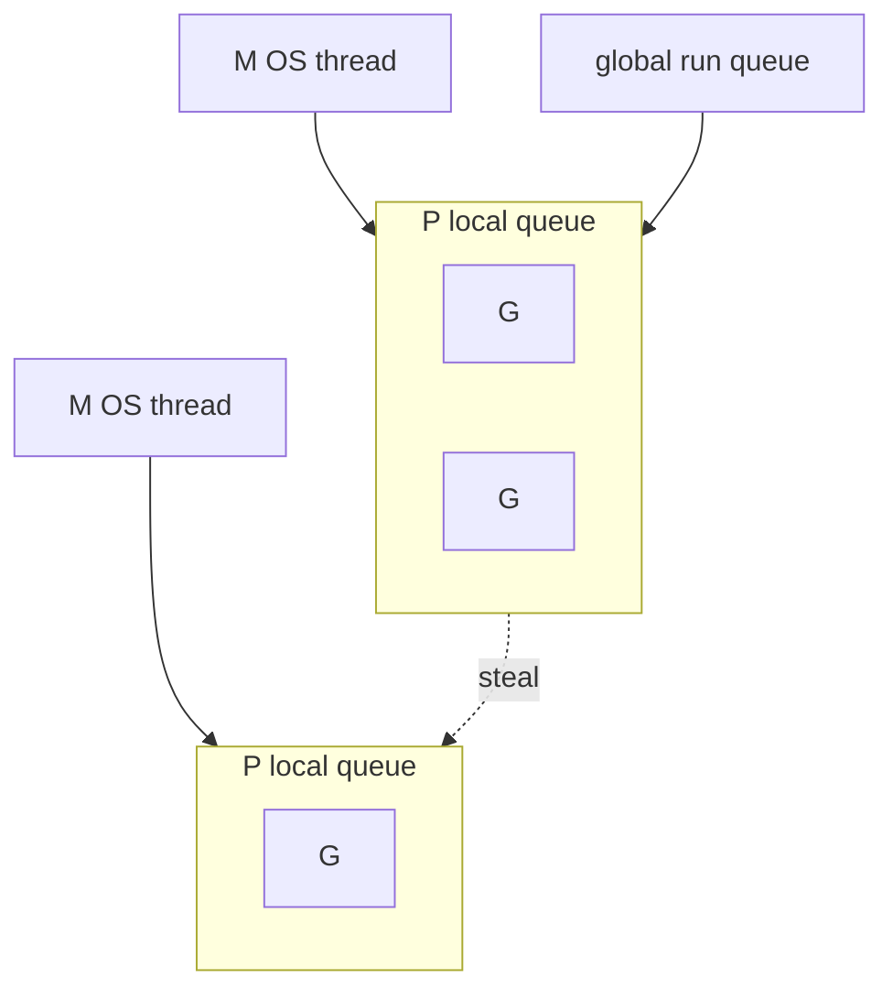

# Level 6 — The runtime

You can say where a value lives, how goroutines get CPU time, what the collector is doing, and how a map is stored. You measure before you rearrange code.

Official pages: [Diagnostics](https://go.dev/doc/diagnostics), [GC guide](https://go.dev/doc/gc-guide), [pprof](https://pkg.go.dev/runtime/pprof), [Go 1.24 release notes](https://go.dev/doc/go1.24) (Swiss tables), [Go 1.25 release notes](https://go.dev/doc/go1.25) (`GOMAXPROCS` in containers), [Go 1.26 release notes](https://go.dev/doc/go1.26) (Green Tea).

## 1. Escape analysis

The stack is per goroutine, starts at about 2 KB, and grows by copying. The heap is where the collector works. You do not choose with a keyword. The compiler does, and it is called escape analysis.

A value can stay on the stack when every reference to it dies before the function returns. It escapes to the heap when a reference outlives the function, or when the compiler cannot prove that it does not.

Typical escapes:

- returning a pointer to a local
- storing a pointer into a heap object, a global, a slice, or a map that itself escapes
- sending a pointer on a channel
- putting a value into an interface, when the data has to be boxed
- a closure that outlives the function and uses the variable
- a slice or map created by `make`: the header may be on the stack, the backing storage is commonly on the heap
- a variable the compiler decides is too large for the stack

Inlining changes the answer. A pointer returned to a caller who never stores it may not escape once the two functions are inlined together.

```bash
go build -gcflags=-m ./internal/money/
go build -gcflags='-m -l' ./internal/money/   # inlining off
```

The printer says `escapes to heap` and `moved to heap`. Do this on a hot function a profile already blamed. Do not rearrange a cold function to please the escape printer.

When they ask how you would remove an allocation:

1. `go test -benchmem` or a heap profile, so you know it matters.
2. `-gcflags=-m` on that function, so you know why.
3. Keep the pointer from escaping: do not box it in an `any`, do not send it on a channel, do not store it in a long-lived map.
4. Reuse the buffer with `sync.Pool`, and reset the length before `Put`.
5. Build strings with `strings.Builder`, not `+` in a loop.
6. Prefer a concrete type over `any` on the hot path.

## 2. The scheduler: G, M, P

G is a goroutine: a stack, a program counter, a status. M is an OS thread. P is a logical processor, a token plus a run queue. An M can execute Go code only while it holds a P. `GOMAXPROCS` is the number of Ps, so it is how many goroutines run Go code at the same time.



Since Go 1.25, on Linux, the default `GOMAXPROCS` is the smaller of the machine’s CPU count and the cgroup CPU limit, rounded up. The Kubernetes CPU request is not consulted. The limit is. The runtime also updates the value when the limit or the CPU count changes. Setting `GOMAXPROCS` in the environment, or calling `runtime.GOMAXPROCS`, turns both behaviors off. `containermaxprocs=0` and `updatemaxprocs=0` turn them off one at a time.

Each P has a local run queue of 256 slots, plus a `runnext` slot for the goroutine just woken. There is one global run queue. A new goroutine usually goes on the local queue of the P that created it. When a P runs out, it takes from the global queue, then steals half of another P’s local queue. That is work stealing.

sysmon is a thread that runs without a P. It preempts goroutines that have run too long, takes back a P whose M has been sitting in a syscall, and can start a GC. Since Go 1.14 preemption is asynchronous: the runtime sends `SIGURG` and the goroutine stops at a safe point, including inside a tight loop that makes no calls. You should not need `runtime.Gosched` in application code.

Two different kinds of blocking. This is why a million connections are not a million threads:

- A blocking syscall parks the G on that M, detaches the P, and hands the P to another M. Other goroutines keep running. When the syscall returns, the M tries to get a P back. Extra Ms exist for syscalls, cgo, and sysmon. `debug.SetMaxThreads`, default 10_000, is a crash limit, not a tuner.
- Network IO uses the netpoller (epoll or kqueue). The G parks, the M keeps its P, and the P runs someone else. When the socket is ready, the netpoller puts the G back on a run queue. Idle connections cost goroutines, not threads.

States worth naming: running, runnable, waiting, syscall.

`GODEBUG=schedtrace=1000` prints a scheduler line once a second. `go tool trace` is the picture. Capture it from a test with `runtime/trace`, or from `/debug/pprof/trace?seconds=5` on a server whose debug port is not public.

## 3. The collector

Go’s collector is a concurrent, parallel, non-moving, non-generational mark-sweep. Green Tea, the default since Go 1.26, changes how marking walks small objects. It does not change that description.

Mark-sweep: objects and pointers are a graph. Roots are globals and goroutine stacks. The mark starts at the roots and paints what it can reach. The sweep frees what was never painted.

Tri-color is how mark runs while the program runs:

| Color | Meaning |
| --- | --- |
| White | Not seen. Still white at the end means garbage. |
| Grey | Seen, its pointers not scanned yet. |
| Black | Scanned. A black object should only point at grey or black objects. |

The mutator is allocating and writing pointers the whole time. The write barrier keeps the invariant. Go uses a hybrid of a Dijkstra insertion barrier and a Yuasa deletion barrier. In words: when a pointer write would hide an object from the marker, or would make a black object point at a white one, the barrier shades the relevant object grey. Stacks are not write-barriered on every store. A stack is grey until it has been scanned, and it is scanned all at once. That hybrid, since Go 1.8, is why stack scanning does not need a second stop-the-world pass.

There are two short stop-the-world windows. One at the start of mark, to turn the barrier on and get the roots. One at the end of mark, to finish the remaining grey objects and shut the barrier off. The long part of mark runs concurrently with your code. The pacer aims for the collector to use about 25% of the CPU while a cycle is running. Sweep is lazy and concurrent: allocating finds unswept spans and sweeps them.

### The two knobs

`GOGC`, default 100. The next collection is paced so the heap can grow to about `live * (1 + GOGC/100)`. At the default, the heap may reach about twice the live data. `GOGC=off` disables that trigger. `GOGC=50` collects more often and holds the heap smaller, at more CPU.

`GOMEMLIMIT` is a soft limit on the memory Go is tracking, for example `512MiB`. As the process approaches it, the pacer runs the collector harder. It will not free objects that are still reachable. If the live set is larger than the limit, the collector runs almost continuously and the process can still be killed by the container. Set the limit below the cgroup memory limit, around 90%, so stacks, and the gap between “Go returns a span” and “the OS sees the RSS drop”, have room. In a container, set `GOMEMLIMIT` and leave `GOGC` at 100, or turn `GOGC` off and let the limit drive collection. A large ballast allocation is the old trick `GOMEMLIMIT` replaced.

Green Tea batches the small objects that live on the same page and scans that page together. Same reachability, better locality. Google’s numbers are roughly 10 to 40 percent less CPU inside the collector, depending on the heap. A program that spends little time in GC will not show that on a dashboard. `GODEBUG=gctrace=1` prints pause time, heap size, and how much was live.

### Reading a heap

A rising heap profile is retained memory: a leak, a cache with no bound, a slice header keeping a large array, a goroutine stuck holding a request. A rising allocation rate with a flat heap is pressure: the collector is keeping up, and the CPU is the cost. Fewer allocations on that path, or a pool, is the fix. A heap that grows to the `GOMEMLIMIT` and sits there, with GC eating a core, is the live set or the limit being wrong.

`runtime.SetFinalizer` can resurrect an object, runs late, and is a bad place to close a file. `runtime.AddCleanup`, since Go 1.24, attaches a function that runs after the object is unreachable and does not resurrect it. Neither replaces `defer Close`.

## 4. sync.Pool

A place to recycle short-lived objects. `Get` may return nothing. The collector may drop the pool at any GC. Reset before `Put`. It is not a cache you can count on.

Each P has a local pool, plus a victim cache of the previous cycle’s objects. A collection may throw the victim away. `Get` calls `New` only when you set `New` and the pool is empty. An object in the pool is not pinned for you. A pool of `[]byte` that sometimes holds a 4 MB buffer and sometimes a 64 B buffer will keep handing out the 4 MB one. Cap what you put in, or use sized pools.

```go
var bufPool = sync.Pool{
    New: func() any { return make([]byte, 0, 4096) },
}

func frame(payload []byte) []byte {
    b := bufPool.Get().([]byte)
    b = b[:0]
    b = append(b, payload...)
    // use b, then:
    if cap(b) <= 64<<10 {
        bufPool.Put(b)
    }
    return nil
}
```

Do not pool objects that hold a request, a connection, or a mutex.

## 5. Atomics and a published config

`atomic.Int64`, `atomic.Pointer[T]`, and the rest of `sync/atomic` are for one variable. `Add` on a counter. `CompareAndSwap` for a flag. `Pointer.Load` and `Store` to publish an immutable structure. Several fields that must be seen together are a mutex, or they are one struct behind one atomic pointer. A plain store to a pointer is a race. Use the atomic.

```go
var current atomic.Pointer[Config]

func Load() *Config { return current.Load() }

func Reload(path string) error {
    cfg, err := parse(path)
    if err != nil {
        return err
    }
    current.Store(cfg)
    return nil
}
```

Readers never lock. A request keeps the `*Config` it loaded, so a reload does not mutate a config a handler is still using. Validate before `Store`. A bad file must leave the current pointer alone.

## 6. Sharding

One mutex puts every core on one cache line. Hash the key into N shards, each with its own map and mutex.

```go
const shardN = 64

type shard struct {
    mu sync.Mutex
    m  map[string]Item
}

type Store struct {
    s [shardN]shard
}

func NewStore() *Store {
    st := &Store{}
    for i := range st.s {
        st.s[i].m = make(map[string]Item)
    }
    return st
}

func (s *Store) shard(key string) *shard {
    h := fnv.New64a()
    _, _ = h.Write([]byte(key))
    return &s.s[h.Sum64()%shardN]
}
```

64 is a starting point. More shards than cores that actually contend, so two hot keys often land apart. FNV is fine. A cryptographic hash is waste. Measure before you invent a lock-free map.

`sync.Map` is two maps: a read-only atomic snapshot and a dirty map under a mutex. It is built for keys that are written once and then read by many goroutines. A cache with a mixed read/write pattern is a `map` plus a `Mutex`, or a set of shards.

## 7. Map internals

Say the language rules first (level 2). Name the version before you describe the picture.

### Through Go 1.23: buckets

The header is an `hmap`: count, flags, `B` where the bucket count is `2^B`, a hash seed, a pointer to the bucket array, a pointer to the old buckets used during growth, and an evacuation cursor.

Each bucket holds up to 8 key/value pairs. Keys sit together and values sit together. Eight tophash bytes let the lookup skip a full key compare. Extra keys chain into an overflow bucket.

The load limit is about 6.5 entries per bucket, counting overflow. Past that, the bucket count doubles. Growth is incremental: later writes evacuate a bucket or two. Deletes do not shrink the bucket array. Iteration starts at a random bucket and a random offset, which is why order changes between processes.

### Go 1.24 and later: Swiss tables

Go 1.24 replaced the bucket map with a Swiss table. Go 1.26 removed the old code. If you describe `hmap` as the current runtime, say you are describing the design through 1.23.

A Swiss table is open-addressed. Slots sit in groups of 8. Each group has an 8-byte control word, one byte per slot: empty `0x80`, deleted tombstone `0xfe`, occupied is the low 7 bits of the hash. The hash splits into `h1` (which group to start at) and `h2` (compared against all 8 control bytes at once). An empty control byte ends the probe. A tombstone does not.

The map is a directory of small tables. Each table holds at most 1024 slots, so one insert does not rehash a multi-gigabyte table. The language rules did not change. Order is still unspecified. Concurrent writes are still fatal. You still cannot take the address of an element.

## 8. Profiles you will actually open

Import `net/http/pprof` on a listener that is not the public port. `127.0.0.1:6060` is the habit.

| You want | You open |
| --- | --- |
| CPU | `/debug/pprof/profile?seconds=30` |
| Live heap | `/debug/pprof/heap` |
| Allocations, including dead ones | `/debug/pprof/allocs` |
| Goroutine stacks | `/debug/pprof/goroutine?debug=2` |
| Leaked, blocked with nothing runnable able to reach them (Go 1.27) | `/debug/pprof/goroutineleak` |
| Mutex | `/debug/pprof/mutex`, after `runtime.SetMutexProfileFraction` |
| Blocking | `/debug/pprof/block`, after `runtime.SetBlockProfileRate` |
| Scheduler and GC | `/debug/pprof/trace?seconds=5`, then `go tool trace` |

```bash
go tool pprof -http=:8081 cpu.prof
go test -bench=. -benchmem -benchtime=5s -count=6 | tee old.txt
# change the code, repeat into new.txt
benchstat old.txt new.txt
```

`top` tells you the functions. `list Func` shows the lines. A CPU flame that is wide in `mallocgc` is an allocation problem. Switch to the alloc profile and find the type. A heap that is one cache is a bound problem. Block and mutex profiles are off until you set a rate. Setting the block rate to 1 records every block and is itself a cost. Use it for a short capture.

`benchstat` wants several runs. One run lies.

## Practice

1. On the slice-leak functions from level 2, run a small program that retains one million 8-byte views of 1 MB buffers, and the copying version. Compare `runtime.ReadMemStats` `HeapAlloc`, or a heap profile. Write both numbers in `NOTES.md`.
2. `go build -gcflags=-m` on a function that returns a pointer to a local, and on a function that returns the struct by value. Paste the two lines.
3. Implement the 64-shard store. Benchmark it against one mutex at 1, 4, and 16 goroutines with `-benchmem`. Keep the command and the machine in `NOTES.md`.
4. Publish a config with `atomic.Pointer`. A test swaps it while readers load. `go test -race` passes.

## Exit checklist

- You can say “escape analysis” as the answer to stack or heap, and you can run `-gcflags=-m`.
- You can name G, M, and P, and you can say which kind of block detaches the P.
- You can state what `GOGC` and `GOMEMLIMIT` do, including that the limit does not free live objects.
- You can describe map buckets through 1.23 and Swiss tables from 1.24, and you name the version.
- You have opened one heap or CPU profile yourself.

Next: [level-07-http.md](level-07-http.md) if you have not done it, then [level-08-pieces.md](level-08-pieces.md).
