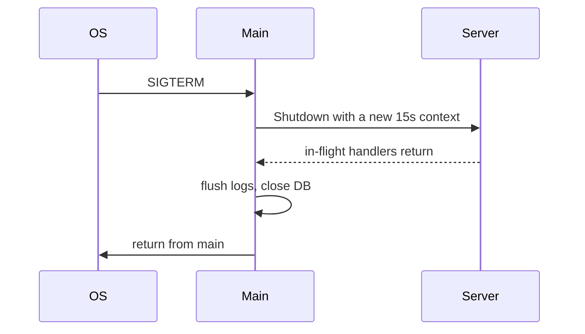

# Level 7 — HTTP, the client, and shutdown

You can serve HTTP with timeouts, call another service without leaking connections, and stop the process when it receives SIGTERM.

The standard library is the server. `net/http` already has the mux, the server, and the client. Add a dependency when you can name what it replaced.

Official pages: [`net/http`](https://pkg.go.dev/net/http), [Server timeouts](https://blog.cloudflare.com/the-complete-guide-to-golang-net-http-timeouts/) (Cloudflare, still the clearest walk-through), [context](https://go.dev/blog/context), [`httputil.ReverseProxy`](https://pkg.go.dev/net/http/httputil).

## 1. A server with timeouts

The zero `http.Server`, and `http.ListenAndServe`, have no timeouts. A client that sends one byte a minute holds a goroutine. That is the slowloris problem.

| Field | What it bounds |
| --- | --- |
| `ReadHeaderTimeout` | How long headers may take. This is the one that stops the slow header. |
| `ReadTimeout` | How long the whole request, body included, may take. |
| `WriteTimeout` | How long the response may take, from the end of the request headers. A long handler or a stream needs this raised, or a per-request deadline through `http.NewResponseController`. |
| `IdleTimeout` | How long a keep-alive connection may sit between requests. Set it. If it is zero, `ReadTimeout` is used in its place, and a short read timeout kills idle connections. |

Since Go 1.22 the mux pattern includes the method. `GET /items/{id}`, then `r.PathValue("id")`. `{path...}` matches the rest, slashes included. A pattern ending in `/` matches that subtree. Two patterns that both match, with neither more specific, panic at registration. Register the routes at startup and let that panic be a boot failure.

```go
mux := http.NewServeMux()
mux.HandleFunc("GET /healthz", func(w http.ResponseWriter, r *http.Request) {
    w.WriteHeader(http.StatusOK)
    _, _ = w.Write([]byte("ok\n"))
})
mux.HandleFunc("GET /v1/accounts/{id}", handleGetAccount)

srv := &http.Server{
    Addr:              ":8080",
    Handler:           mux,
    ReadHeaderTimeout: 2 * time.Second,
    ReadTimeout:       5 * time.Second,
    WriteTimeout:      10 * time.Second,
    IdleTimeout:       60 * time.Second,
}
```

Write the status, then the body. The first `Write` sends 200 if you have not called `WriteHeader`. Headers set after that are ignored.

Limit a body before you decode it:

```go
r.Body = http.MaxBytesReader(w, r.Body, 1<<20)
var p Payment
if err := json.NewDecoder(r.Body).Decode(&p); err != nil {
    http.Error(w, "bad json", http.StatusBadRequest)
    return
}
```

## 2. Middleware

Middleware is a function from `http.Handler` to `http.Handler`. Call the next handler, or finish the response. Do not do both.

```go
func withMethod(next http.Handler) http.Handler {
    return http.HandlerFunc(func(w http.ResponseWriter, r *http.Request) {
        if r.Method != http.MethodPost && r.URL.Path == "/v1/transfers" {
            http.Error(w, "method", http.StatusMethodNotAllowed)
            return
        }
        next.ServeHTTP(w, r)
    })
}
```

With Go 1.22 patterns you usually put the method in the pattern and skip this wrapper. The shape still matters for logging, request ids, and recovery at the edge of code you own.

Pass `r.Context()` into every call that does IO. When the client goes away, that context is cancelled.

## 3. Health

`/healthz` means the process is up. `/readyz` means it should receive traffic: the database ping succeeded, the config loaded. A readiness failure takes the pod out of the Service. A liveness failure restarts it. Do not put a database ping on liveness, or a database blip restart-loops every pod.

## 4. The client

`http.Get` uses `http.DefaultClient`, which has no timeout. Build one `http.Client`, set `Timeout`, and keep it. `Timeout` covers dial, TLS, redirects, and reading the body. `NewRequestWithContext` is how one call dies sooner, and how cancel reaches the transport.

`Do` returns a nil error for a 404. The status code is the check. Close the body. Read it to the end, including when the status is not the one you wanted, or the connection cannot be reused. `io.Copy(io.Discard, resp.Body)` is the drain.

```go
func get(ctx context.Context, c *http.Client, url string) ([]byte, error) {
    req, err := http.NewRequestWithContext(ctx, http.MethodGet, url, nil)
    if err != nil {
        return nil, err
    }
    resp, err := c.Do(req)
    if err != nil {
        return nil, err
    }
    defer resp.Body.Close()
    body, err := io.ReadAll(io.LimitReader(resp.Body, 1<<20))
    if err != nil {
        return nil, err
    }
    if resp.StatusCode != http.StatusOK {
        return nil, fmt.Errorf("status %d", resp.StatusCode)
    }
    return body, nil
}
```

The connection returns to the pool only after the body is fully read and closed. Otherwise every call opens a new TCP connection.

Transport defaults, because “the pool dried up” has two causes:

- Body not closed, or not drained. That connection never goes idle.
- `MaxIdleConnsPerHost` defaults to 2 (`DefaultMaxIdleConnsPerHost`). `MaxIdleConns` is 100. Under concurrency above 2 to one host, HTTP/1 throws connections away and handshakes again.
- `MaxConnsPerHost` at zero means no cap on connections in any state.
- `IdleConnTimeout` is 90s. `TLSHandshakeTimeout` is 10s. `ExpectContinueTimeout` is 1s.

HTTP/2 multiplexes many streams on one connection, so the idle-per-host number matters most for HTTP/1. A single HTTP/2 connection can still be too few. Look at the transport if the profile shows stalls in `roundTrip`.

```go
tr := &http.Transport{
    MaxIdleConns:        100,
    MaxIdleConnsPerHost: 32,
    IdleConnTimeout:     90 * time.Second,
}
client := &http.Client{Timeout: 5 * time.Second, Transport: tr}
```

Build the client once. A new `Client` per call is a new pool per call.

## 5. Shutdown

Stop accepting. Wait for in-flight work on a fresh timeout, not on the already-cancelled signal context. Flush telemetry. Close the database pool. Then exit.



```go
ctx, stop := signal.NotifyContext(context.Background(), os.Interrupt, syscall.SIGTERM)
defer stop()

errCh := make(chan error, 1)
go func() {
    errCh <- srv.ListenAndServe()
}()

select {
case err := <-errCh:
    if err != nil && !errors.Is(err, http.ErrServerClosed) {
        return err
    }
case <-ctx.Done():
    shut, cancel := context.WithTimeout(context.Background(), 15*time.Second)
    defer cancel()
    if err := srv.Shutdown(shut); err != nil {
        return err
    }
}
```

`ListenAndServe` returns `http.ErrServerClosed` after a clean `Shutdown`. That error is success. `os.Exit` skips defers. Return from `main` when you can.

`Server.Shutdown` stops accepting and waits for connections to go idle, until its context fires. Handlers notice `r.Context()` and return.

## 6. Reverse proxy, the shape only

`httputil.ReverseProxy` is the gateway primitive. Give it a `Director` or `Rewrite`, an `ErrorHandler`, and a `Transport` you tuned. `FlushInterval` of -1 flushes after every write, which is what a stream wants. Hop-by-hop headers are stripped for you.

Set `X-Forwarded-For` only if you trust the previous hop. A proxy that forwards a client-supplied forwarded-for header is how an internal allow-list gets bypassed.

You build the full gateway in month 5, after level 8. This level’s job is to know which type you would start from, and which timeouts you would set before the first request.

## Practice

1. An `http.Server` with all four timeouts set. `GET /healthz` returns 200. `GET /v1/accounts/{id}` returns JSON. A test uses `httptest.NewServer`.
2. A client helper that closes and drains the body. A test against `httptest` returns a 404 and asserts your function returns an error and that a second call still works (the connection was reusable).
3. Wire `signal.NotifyContext` and `Shutdown`. You can send the process an interrupt from a terminal and watch it exit. In a test, call `Shutdown` directly.
4. `POST` with a body larger than `MaxBytesReader` allows, and assert 400.

## Exit checklist

- You can name the four server timeouts and which one stops a slow header.
- You build one `http.Client` with a `Timeout` and a raised `MaxIdleConnsPerHost`.
- You close and drain every response body.
- You shut down on a fresh timeout context, not on the signal context.
- `/healthz` and `/readyz` mean different things, and you can say which one pings the database.

Next: [level-08-pieces.md](level-08-pieces.md).
