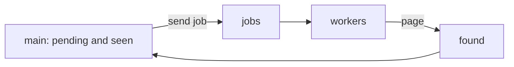
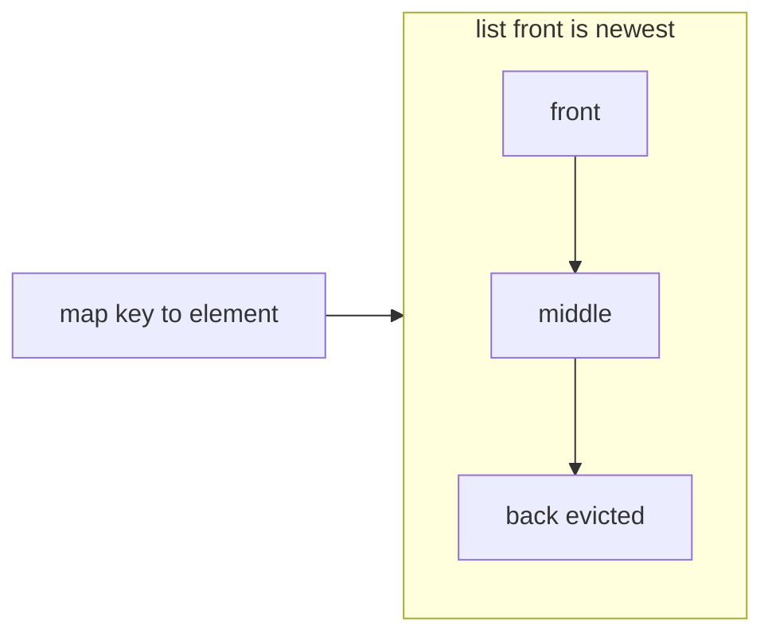
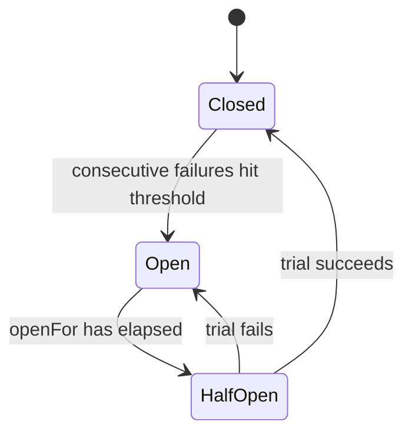

# Level 8 — Pieces you are asked to write

Each section is a problem you should be able to write in a blank editor after you have studied it. Talk for thirty seconds before you type. Name the bound, the owner of the close, and how cancel works. Then write the small version.

The worker pool is in [level 5](level-05-concurrency.md). This level is the rest of the timed set, plus the in-process limiter and breaker that month 2 builds.

Type these into `drills/` in a module of your own. Test first. The snippets here are the reference after you have tried, and the thing you re-read the night before.

## 1. Crawler

The trap is a worker sending the next URL back onto the same channel it receives from. If every worker is blocked on that send, nobody is left to receive. Main is the only sender on `jobs`. Workers send results on `found`.



A nil send channel disables that `select` case while the pending list is empty. `inflight` hits zero when every issued job has produced one result. Visited is checked once, in main, before a URL is queued, so two workers cannot fetch the same URL.

```go
type item struct {
    u string
    d int
}

type page struct {
    depth int
    links []string
}

func Crawl(ctx context.Context, seeds []string, workers, maxDepth int,
    fetch func(context.Context, string) ([]string, error)) error {

    jobs := make(chan item)
    found := make(chan page)
    var wg sync.WaitGroup
    wg.Add(workers)
    for range workers {
        go func() {
            defer wg.Done()
            for {
                select {
                case <-ctx.Done():
                    return
                case j, ok := <-jobs:
                    if !ok {
                        return
                    }
                    links, err := fetch(ctx, j.u)
                    if err != nil || j.d >= maxDepth {
                        links = nil
                    }
                    select {
                    case <-ctx.Done():
                        return
                    case found <- page{j.d, links}:
                    }
                }
            }
        }()
    }

    seen := map[string]bool{}
    pending := make([]item, 0, len(seeds))
    for _, s := range seeds {
        if !seen[s] {
            seen[s] = true
            pending = append(pending, item{s, 0})
        }
    }
    inflight := 0

    for len(pending) > 0 || inflight > 0 {
        var send chan item
        var next item
        if len(pending) > 0 {
            send = jobs
            next = pending[0]
        }
        select {
        case <-ctx.Done():
            close(jobs)
            wg.Wait()
            return ctx.Err()
        case send <- next:
            pending = pending[1:]
            inflight++
        case pg := <-found:
            inflight--
            for _, link := range pg.links {
                if seen[link] {
                    continue
                }
                seen[link] = true
                pending = append(pending, item{link, pg.depth + 1})
            }
        }
    }
    close(jobs)
    wg.Wait()
    return nil
}
```

`fetch` errors drop the links and still return a page, so `inflight` cannot stick. On cancel, closing `jobs` unblocks workers parked on receive. Workers parked on `found` also select on `ctx.Done()`.

If they say “keep it smaller”, a semaphore around one goroutine per URL is the short answer. Say the cost: one goroutine per URL, blocked on the semaphore, which is a lot of stacks on a large site. The version above bounds both fetches and goroutines.

## 2. Transfer without deadlock

Lock accounts in a global order. The order is the account id, not the direction of the money. Swap the lock order and you swap who gets debited.

```go
func (b *Bank) Transfer(from, to string, amt int64) error {
    if from == to || amt <= 0 {
        return errBad
    }
    first, second := from, to
    if second < first {
        first, second = second, first
    }
    b.lock[first].Lock()
    defer b.lock[first].Unlock()
    b.lock[second].Lock()
    defer b.lock[second].Unlock()
    if b.bal[from] < amt {
        return errShort
    }
    b.bal[from] -= amt
    b.bal[to] += amt
    return nil
}
```

One mutex around the whole bank is correct and simpler. Use it when they have not asked for concurrency across accounts. Lock ordering is the answer when they say the single lock is too coarse.

A missing account, and an unknown lock in the map, is the follow-up: the map of locks needs its own mutex, or the account set is fixed at the start. Creating a lock lazily under two different calls is a race.

## 3. Pub/sub that does not block the publisher

A slow subscriber must not stall the publisher, and a send must not wait while you hold the map’s mutex. The send below is non-blocking, so doing it under the lock is safe. If the subscriber set is large enough that the range itself shows up in a profile, copy the channels out under the lock and send after you unlock. Make the map in the constructor. A nil map panics on the first subscribe.

```go
type broker struct {
    mu   sync.Mutex
    subs map[int]chan string
    next int
}

func (b *broker) Subscribe() (int, <-chan string) {
    ch := make(chan string, 16)
    b.mu.Lock()
    defer b.mu.Unlock()
    id := b.next
    b.next++
    b.subs[id] = ch
    return id, ch
}

func (b *broker) Publish(msg string) {
    b.mu.Lock()
    defer b.mu.Unlock()
    for id, ch := range b.subs {
        select {
        case ch <- msg:
        default:
            close(ch)
            delete(b.subs, id)
        }
    }
}
```

The buffer is the slack. The `default` drops a subscriber who is behind. The other policy is to drop the message for that subscriber and keep them. Say which one you picked. Closing the channel ends the subscriber’s `range`. Only the publisher closes it, and only after removing it, so a later publish does not send on a closed channel.

## 4. TTL cache

One map, one mutex, unless a profile says to shard. Store the value and the deadline. On `Get`, if the deadline has passed, delete and report a miss. A janitor is a single goroutine with one `Ticker`, started with the cache and stopped by `Close`, that scans and deletes expired keys. Do not start a janitor per request.

Misses under load use `singleflight` so a thousand concurrent gets of a cold key become one fetch. The flight is not the cache. After `Do` returns, store the value with a deadline. Inject a clock function (`func() time.Time`) so a test does not sleep.

`Get` copies the value out under the lock and returns the copy. A pointer into the cache, used after unlock, races with the janitor.

```go
type entry struct {
    val    string
    expiry time.Time
}

type Cache struct {
    mu    sync.Mutex
    items map[string]entry
    now   func() time.Time
}

func (c *Cache) Get(k string) (string, bool) {
    c.mu.Lock()
    defer c.mu.Unlock()
    e, ok := c.items[k]
    if !ok || !c.now().Before(e.expiry) {
        delete(c.items, k)
        return "", false
    }
    return e.val, true
}

func (c *Cache) Set(k, v string, ttl time.Duration) {
    c.mu.Lock()
    defer c.mu.Unlock()
    c.items[k] = entry{val: v, expiry: c.now().Add(ttl)}
}
```

## 5. LRU

`container/list` for the order, a map from key to `*list.Element` for the lookup. Front is most recently used. `Get` moves to front. `Put` of a new key at capacity removes the back, deletes it from the map, and pushes front. One mutex around both structures. They are one invariant.



```go
type pair struct {
    k, v string
}

type LRU struct {
    mu  sync.Mutex
    cap int
    ll  *list.List
    m   map[string]*list.Element
}

func NewLRU(n int) *LRU {
    return &LRU{cap: n, ll: list.New(), m: make(map[string]*list.Element)}
}

func (l *LRU) Get(k string) (string, bool) {
    l.mu.Lock()
    defer l.mu.Unlock()
    el, ok := l.m[k]
    if !ok {
        return "", false
    }
    l.ll.MoveToFront(el)
    return el.Value.(pair).v, true
}

func (l *LRU) Put(k, v string) {
    l.mu.Lock()
    defer l.mu.Unlock()
    if el, ok := l.m[k]; ok {
        el.Value = pair{k, v}
        l.ll.MoveToFront(el)
        return
    }
    if l.ll.Len() == l.cap {
        back := l.ll.Back()
        l.ll.Remove(back)
        delete(l.m, back.Value.(pair).k)
    }
    el := l.ll.PushFront(pair{k, v})
    l.m[k] = el
}
```

## 6. Hedged request

Cancel the losers when the first success arrives. Buffer the result by one so the winner’s send does not block on a main that has moved on. Wait for the losers to leave, or you leak them.

```go
func First(ctx context.Context, urls []string) ([]byte, error) {
    if len(urls) == 0 {
        return nil, errEmpty
    }
    ctx, cancel := context.WithCancel(ctx)
    defer cancel()
    var wg sync.WaitGroup
    ch := make(chan []byte, 1)
    errCh := make(chan error, len(urls))
    for _, u := range urls {
        wg.Add(1)
        go func() {
            defer wg.Done()
            body, err := get(ctx, u)
            if err != nil {
                errCh <- err
                return
            }
            select {
            case ch <- body:
                cancel()
            default:
            }
        }()
    }
    wg.Wait()
    select {
    case body := <-ch:
        return body, nil
    default:
        return nil, <-errCh
    }
}
```

`context.Canceled` on a loser is not a failure of that replica. If you need the first real error, ignore `context.Canceled` after you have cancelled. `get` must use the context, or cancel does not stop the HTTP call.

## 7. errgroup, from scratch

They ask this to see `Add` outside the goroutine, `Once` for the first error, and cancel on that error.

```go
type Group struct {
    cancel func()
    wg     sync.WaitGroup
    once   sync.Once
    err    error
}

func (g *Group) Go(fn func() error) {
    g.wg.Add(1)
    go func() {
        defer g.wg.Done()
        defer func() {
            if r := recover(); r != nil {
                g.fail(fmt.Errorf("panic: %v", r))
            }
        }()
        if err := fn(); err != nil {
            g.fail(err)
        }
    }()
}

func (g *Group) fail(err error) {
    g.once.Do(func() {
        g.err = err
        if g.cancel != nil {
            g.cancel()
        }
    })
}

func (g *Group) Wait() error {
    g.wg.Wait()
    return g.err
}
```

The real errgroup also has a limit. A limit is a channel semaphore acquired before the goroutine does the work, or a counter with a `Cond`. Say which. The panic recover is a choice. The standard errgroup does not recover. Mention that if you add it.

## 8. In-place slice work and a k-way merge

Filtering without an allocation reuses the backing array. The caller must accept that `in` was overwritten.

```go
func keep(in []int, want func(int) bool) []int {
    n := 0
    for _, v := range in {
        if want(v) {
            in[n] = v
            n++
        }
    }
    return in[:n]
}
```

Dedup of a sorted slice is the same loop, keeping `v` when it differs from the previous kept value.

K-way merge: a min-heap of the current head of each sorted slice. `container/heap`. Each element is the value plus which slice it came from, so you pull the next element from that slice only. Output is sorted, and you never hold more than K heads. For channels, the same heap, and each pop reads the next value from that channel. Cancel by selecting on `ctx.Done()` in the goroutine that does the reads. A channel version that starts one goroutine per input and dumps into one channel is a merge, and it is not sorted.

## 9. Token bucket

Per key: capacity `burst`, refill `rate` tokens per second. `Allow` takes `now` so tests advance a fake clock and never sleep. Refill is `elapsed * rate`. Cap the token count at `burst`. The first call for a new key starts full.

```go
type bucket struct {
    tokens float64
    last   time.Time
}

func (l *Limiter) Allow(now time.Time, key string) (bool, time.Duration) {
    l.mu.Lock()
    defer l.mu.Unlock()
    b := l.keys[key]
    if b.last.IsZero() {
        b.tokens = l.burst
        b.last = now
    } else {
        b.tokens += now.Sub(b.last).Seconds() * l.rate
        if b.tokens > l.burst {
            b.tokens = l.burst
        }
        b.last = now
    }
    if b.tokens < 1 {
        l.keys[key] = b
        retry := time.Duration((1 - b.tokens) / l.rate * float64(time.Second))
        return false, retry
    }
    b.tokens--
    l.keys[key] = b
    return true, 0
}
```

Know the other windows well enough to draw them:

| Limiter | Memory | Burst at a window boundary |
| --- | --- | --- |
| Fixed window | one counter | Can admit two full windows back to back, one on each side of the boundary |
| Sliding log | one timestamp per hit | Exact. Memory grows with traffic |
| Sliding counter | two counts | Approximate. Weight the previous window by how far you are into the current one |
| Token bucket | one token count and a timestamp | Smooth. Burst is capped at `burst` |

HTTP: denied requests get `429` and `Retry-After` in seconds, rounded up. Key the limiter per user or API key. A denied request must not count as a failure in the circuit breaker.

## 10. Circuit breaker



- `Closed`: failures increment. At `failureThreshold` consecutive failures, move to `Open` until `now+openFor`.
- `Open`: `Allow` returns `ErrOpen` and does not call the function. After the deadline, the next call is `HalfOpen`.
- `HalfOpen`: one trial. Success goes to `Closed` and clears the counter. Failure goes back to `Open`.

The state transition touches more than one field, so a mutex protects it. An atomic counter is enough for a single number that has no sibling field. Write down which is which in your notes. `context.Canceled` is not an upstream failure. Do not trip the breaker on it.

## Practice

Do these closed-book, one per sitting. Time the first four at 45 minutes once the code is familiar.

1. Crawler, with a fake `fetch` and a cancel test. `goleak` is clean.
2. Transfer. A test runs transfers in both directions on the same pair under `-race`.
3. LRU with capacity 2: put A, B, C and assert A is gone. Get B, put D, assert C is gone.
4. Token bucket with a fake clock: burst allowed immediately, the next call denied, advancing the clock allows one more, a long advance does not exceed `burst`.
5. Breaker: a call during `Open` does not run the function. Prove it with a counter inside the function.

## Exit checklist

- You can say why the crawler’s workers do not send URLs on `jobs`.
- You lock two accounts in id order, and you can say when one bank-wide mutex is the better answer.
- You can describe the pub/sub drop policy you picked.
- Cache `Get` returns a copy. The janitor is one goroutine.
- You can draw the breaker states and you can name the fixed-window boundary burst.

Next: [level-09-data.md](level-09-data.md).
