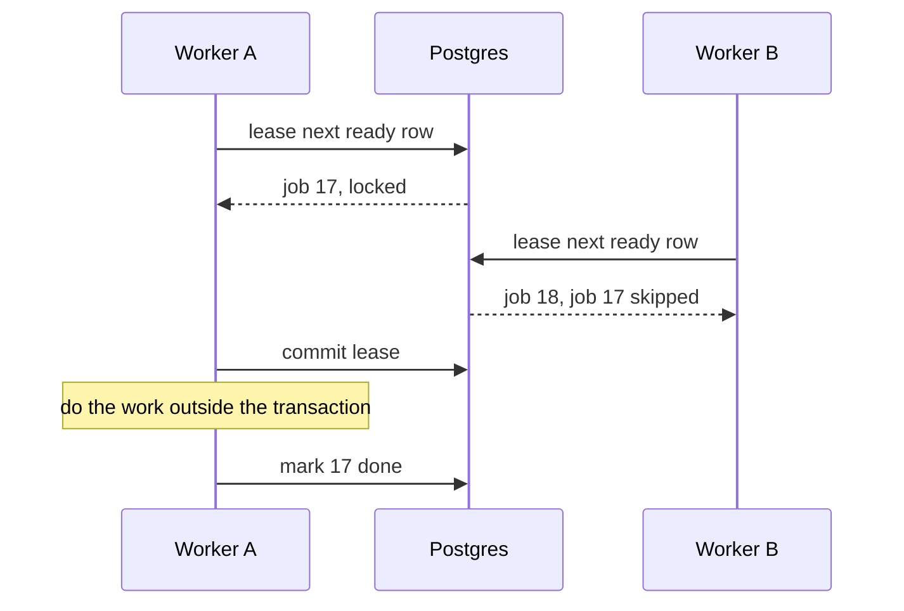
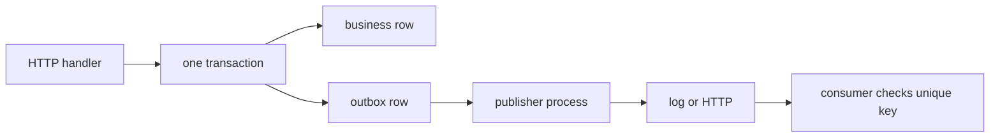

# Level 9 — SQL, jobs, and the outbox

You can use `database/sql` without exhausting the database, claim a job without waiting on someone else’s row, and publish an event in the same transaction as the business write.

Official pages: [database tutorial](https://go.dev/doc/tutorial/database-access), [Accessing relational databases](https://go.dev/doc/database/), [`database/sql`](https://pkg.go.dev/database/sql), [Canceling SQL](https://go.dev/doc/database/cancel-operations), Postgres [`SELECT`](https://www.postgresql.org/docs/current/sql-select.html) for `FOR UPDATE SKIP LOCKED`.

The driver is a dependency (`pgx`, or `lib/pq`). The pool API below is `database/sql`. `pgxpool` has the same knobs under different names. Be able to say what you added the driver for: the wire protocol, not a second query language.

## 1. The pool is not a connection

`sql.Open` checks the driver name and returns a pool. It does not connect. `PingContext` connects. Always call the `Context` variant.

```go
db, err := sql.Open("pgx", dsn)
if err != nil {
    return err
}
db.SetMaxOpenConns(20)
db.SetMaxIdleConns(20)
db.SetConnMaxLifetime(30 * time.Minute)
db.SetConnMaxIdleTime(5 * time.Minute)

ctx, cancel := context.WithTimeout(context.Background(), 2*time.Second)
defer cancel()
if err := db.PingContext(ctx); err != nil {
    return err
}
```

| Knob | Default that bites | What you set |
| --- | --- | --- |
| `SetMaxOpenConns` | unlimited | A number the database can accept from this process, times the number of processes |
| `SetMaxIdleConns` | 2 | Less than or equal to the open cap, high enough that you do not dial on every query |
| `SetConnMaxLifetime` | forever | Rotates connections out from under a proxy that kills idle sockets silently |
| `SetConnMaxIdleTime` | forever | Drops idle connections you are not using |

A connection that fails is discarded by the pool. The next call dials.

## 2. Rows and the missing row

`rows.Close` returns the connection to the pool. `defer rows.Close()`. After the loop, check `rows.Err()`, which is how an error during iteration is reported once `Next` has returned false. `Scan` writes into pointers.

```go
func (s *Store) Account(ctx context.Context, id string) (Account, error) {
    row := s.db.QueryRowContext(ctx,
        `SELECT id, paise, currency FROM accounts WHERE id = $1`, id)
    var a Account
    err := row.Scan(&a.ID, &a.Paise, &a.Currency)
    if errors.Is(err, sql.ErrNoRows) {
        return Account{}, ErrNotFound
    }
    if err != nil {
        return Account{}, fmt.Errorf("account %s: %w", id, err)
    }
    return a, nil
}
```

`ErrNoRows` is a missing row. Map it to your sentinel. It is not a 500.

`defer rows.Close()` inside the function that owns the rows is correct. A loop that calls `Query` and defers inside the loop holds every connection until the outer function returns. Close before the next query, in a helper.

## 3. Transactions

`BeginTx`, and `defer tx.Rollback()`. Rollback after a successful `Commit` returns `sql.ErrTxDone`, which you can ignore. Commit only on the success path. Hold the transaction across the statements that are one invariant. Do not hold it across an HTTP call.

```go
func (s *Store) Transfer(ctx context.Context, from, to string, paise int64) error {
    tx, err := s.db.BeginTx(ctx, nil)
    if err != nil {
        return err
    }
    defer tx.Rollback()

    // statements that must commit together
    if err := debit(ctx, tx, from, paise); err != nil {
        return err
    }
    if err := credit(ctx, tx, to, paise); err != nil {
        return err
    }
    return tx.Commit()
}
```

Postgres default isolation is Read Committed. A lost update is a `SELECT` then an `UPDATE` with no lock and no version check. Fix it with `UPDATE ... WHERE id = $1 AND version = $2`, or with `SELECT ... FOR UPDATE` inside the transaction.

## 4. SKIP LOCKED

`SELECT ... FOR UPDATE SKIP LOCKED` is the job-queue answer. Inside a transaction, the rows that match are locked, except rows another transaction already locked, which are skipped. Each worker gets a different row. Nobody waits on the row someone else is processing.

You need an index that matches the `WHERE` and the `ORDER BY`, or the database locks more rows than you think while it finds the one you want. The lock lasts until commit or rollback. Keep the transaction short: mark the job leased, commit, do the work, then a second transaction marks it done.

```sql
UPDATE jobs
SET status = 'leased',
    lease_expires_at = now() + interval '30 seconds'
WHERE id = (
    SELECT id FROM jobs
    WHERE status = 'ready' AND run_at <= now()
    ORDER BY run_at
    FOR UPDATE SKIP LOCKED
    LIMIT 1
)
RETURNING id, payload;
```



A worker that dies mid-job leaves the row leased. A reaper sets `status` back to ready where `lease_expires_at < now()`, increments `attempt`, and sets the next `run_at` with exponential backoff and jitter. Past `max_attempts`, set `dead`. Jitter matters. Without it, every failed job in a bad minute becomes runnable in the same later second.

## 5. Idempotency

Idempotency is a unique key, not a check-then-insert. Insert the idempotency key in the same transaction as the work. A second delivery hits the unique violation and returns the original result.

Payment providers deliver at least once. The handler must do the work once. That is the webhook paragraph.

```sql
INSERT INTO payments (provider_event_id, paise, status)
VALUES ($1, $2, 'received')
ON CONFLICT (provider_event_id) DO NOTHING
RETURNING id;
```

Zero rows back means you already stored this event. Load the original row and return it.

## 6. The outbox

Publish without a dual write. In the same transaction as the business row, insert an outbox row. A separate process reads the outbox, publishes, and marks the row sent. If the process crashes after publish and before the mark, it publishes again. Consumers are idempotent, which is the unique key above.



`SKIP LOCKED` lets several publishers share the outbox. A separate log (Kafka, or the product you already run) is the alternative when the log is the product. For a moderate queue owned by one Postgres, the table commits with the data. The trade: the table couples publish throughput to the database, and a separate log does not.

Do the payment work in the worker, not in the HTTP handler. The handler checks the signature, writes the event, and returns 200 once that commit lands. A slow downstream in the handler makes the provider retry, and the retries are the storm.

## 7. Redis, when the delay must be sub-second

A sorted set, score equal to the run-at unix time. A Lua script pops the members whose score is due and moves them to a list, in one round trip, so two pollers cannot take the same member. Lua is the answer any time a check and a write to Redis must be one atomic step. A rate limit is the same shape: a sliding window or a token bucket in one script.

If Redis is down, a process-local limiter (level 8) keeps you alive. Say the cost: each replica then allows the full limit, so the global cap becomes limit times replicas.

You do not need to memorize a Lua script on the first pass. You need to say why the check and the write are one script, and what you do when Redis is unreachable.

## 8. A Bitcask-shaped store, the picture

This is the design month 3 builds. Read it here so the SQL job queue and the log-structured store are different answers to different questions.

Append the record to an active segment: checksum, timestamp, key, value. The in-memory index maps the key to file id, offset, and size. Reads are one index lookup and one pread. Writes are one append. A crash rebuilds the index by scanning the segments. A torn tail fails the checksum and is truncated. `file.Sync` is the promise of durability past process death, and it has a cost you can measure.

```text
segment file, append only
[CRC32 4][timestamp 8][key len 2][value len 4][key][value]
```

The index is the sharded map from level 6. Compaction reads immutable segments, writes a new segment that keeps only the newest live key, swaps it in, and deletes the old files. Readers keep working during the swap. Atomic rename is the file-level publish. Tombstones are how a delete wins against an older value in an older segment.

This is not the design for a multi-node strongly consistent store. For that, say Raft, or say you would run something that already has it, and talk about the index, the lease, and the client timeout.

## Practice

1. Against a real Postgres, or a container you start yourself: create `accounts` and `jobs`. `SetMaxOpenConns`. `PingContext`.
2. `Account` returns `ErrNotFound` on a missing id. A test asserts `errors.Is`.
3. The lease statement above, called from two transactions at once, returns two different ids. Write that test.
4. Insert a payment twice with the same `provider_event_id`. The second insert does not create a second row.
5. On paper, one transaction that inserts the payment and the outbox row. Name the process that publishes, and name what the consumer’s unique key is.

## Exit checklist

- You can say `sql.Open` does not connect, and you can name the four pool knobs.
- You `defer rows.Close()` and you check `rows.Err()`.
- You can explain `SKIP LOCKED` as “lock the next free row, skip rows another worker holds”, and you keep the lease transaction short.
- Idempotency is a unique constraint in the same transaction as the work.
- You can draw the outbox: one transaction, a publisher, an idempotent consumer.

Next: [level-10-interview.md](level-10-interview.md).
