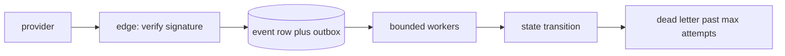

# Level 10 — Designs, bugs, and the sentences

This is the spoken level. The code lives in the earlier files. Here you practice saying the shape, the failure, and the Go-specific choice in about fifteen minutes, then you repair the bugs they paste.

Read [level 6](level-06-runtime.md) again for profiles. Read [level 8](level-08-pieces.md) again for the pieces you would point at.

## 1. How to spend the fifteen minutes

Draw three boxes. Name the data each box stores. Name one failure and what the caller sees. Name the Go type you would actually use. Stop. They will pull on the thread they care about.

Numbers on a resume come from a load test you ran. Write the machine spec next to the number.

## 2. Payment webhooks, about 50k per second

The edge accepts the HTTP call, checks the signature, and writes the event. The write is the business row plus the outbox, or the event table with a unique provider-event id. The response is 200 once that commit lands. The payment work is not in the handler. A slow downstream would make the provider retry, and the retries are the storm.

Workers lease with `SKIP LOCKED` or read from the log. The handler checks the idempotency key, applies the state transition, and commits. Unknown states are a dead letter, not a retry loop. Retries use backoff with jitter. A poison message hits `max_attempts` and parks, with the last error stored on the row.

Hot path in Go:

- The HTTP server has timeouts.
- The body is limited with `http.MaxBytesReader`.
- JSON is decoded into a struct, not into `map[string]any`. A number in `any` becomes `float64` and loses integers above 2^53.
- The worker pool is bounded.
- One bad payload returns an error. It does not kill the process. `net/http` recovers a panic in a handler. A panic in a goroutine you started does not.

Say what you do not build: a workflow engine, unless the transitions are actually a workflow. A single table and a lease is enough for “call this URL until it works”.

## 3. API gateway, about 100k requests per second

A couple of milliseconds added, so the proxy itself has to be boring.

`httputil.ReverseProxy` with a tuned `Transport`. Reuse connections. Raise `MaxIdleConnsPerHost`. Timeouts on the proxy and on the upstream dial.

The load balancer is an interface with three implementations:

- round-robin via `atomic.Add`
- least-connections via an `atomic.Int64` per upstream
- consistent hash when a client should stick to a backend

Health is an active probe of `/readyz` plus a passive eject: N consecutive 502, 503, or 504 responses, or a timeout streak, pulls the target out. A recovered probe puts it back.

Rate limit in a Redis Lua script so the decision is one round trip, with a local token bucket (`golang.org/x/time/rate`, or the one you wrote in level 8) when Redis fails. Say the degraded limit out loud: each replica allows the full limit, so the global cap becomes limit times replicas.

`singleflight` in front of a cacheable GET so a miss stampede is one upstream call. Config is an `atomic.Pointer[Config]` swapped on file change or on a watch. A bad config is rejected and the old pointer stays. No reader lock on the request path.

## 4. Log ingest, about a million events per second

Do not parse into a fat struct and allocate a string per field if the profile says the CPU is the parser. A length-prefixed frame, a reuse of buffers from a pool, and a batch write. The ingest goroutine applies backpressure: a bounded queue, and when it is full, reject or shed, with a metric. An unbounded channel is a slow leak that ends in an OOM kill.

`GOMEMLIMIT` is set below the container limit so the collector runs before the cgroup kills you. It is not a license to buffer without bound.

Batch the database or the log writer. One insert of N rows, or one append of N frames, per fsync. The failure mode is a full disk or a slow consumer. Shed at the front of the pipeline, where the client can retry, rather than blocking every producer.

## 5. A key-value store

Use the picture in level 9: append-only segment, in-memory index, checksum on the torn tail, compaction by atomic rename, tombstones, `file.Sync` when you promise durability past process death. The index is sharded. This is one node. Multi-node strong consistency is Raft, or a system that already has it.

## 6. Profiles, said in one pass

| You want | You open |
| --- | --- |
| CPU | `/debug/pprof/profile?seconds=30` |
| Live heap | `/debug/pprof/heap` |
| Allocations, including dead ones | `/debug/pprof/allocs` |
| Goroutine stacks | `/debug/pprof/goroutine?debug=2` |
| Leaked, blocked with no runnable reach (Go 1.27) | `/debug/pprof/goroutineleak` |
| Mutex holders | `/debug/pprof/mutex`, after `runtime.SetMutexProfileFraction` |
| Channel and syscall blocking | `/debug/pprof/block`, after `runtime.SetBlockProfileRate` |
| Scheduler and GC picture | `/debug/pprof/trace?seconds=5`, then `go tool trace` |

The listener is not the public port. A CPU flame that is wide in `mallocgc` is an allocation problem. A heap that is one cache is a bound problem. `benchstat` compares runs. One run lies.

Escape check: `go build -gcflags=-m ./pkg/store/`. Race check: `go test -race ./...`.

## 7. The bugs

Say the first sentence of the repair. Then the fix.

| What you see | What you say |
| --- | --- |
| `err != nil` is true, the pointer inside is nil | Return a bare nil. The interface held a type. |
| Outer `err` is still nil | `:=` in the inner block created a new `err`. Use `=`. |
| `append` corrupted another slice | The subslice still had capacity. Three-index slice, or `slices.Clone`. |
| Every goroutine printed the last item | `go` line before 1.22. Pass the variable into the function. |
| `concurrent map read and map write` | Mutex around every access, or stop sharing the map. `recover` will not catch this. |
| Workers still running after return | They are blocked on a send nobody receives. Cancel, or keep receiving until they finish. |
| `Wait` returned immediately | `Add` ran inside the goroutine, after `Wait` saw zero. `Add` first. |
| Server hangs on a slow client | No `ReadHeaderTimeout`. Build an `http.Server`. |
| Ports exhausted, new conns every request | Body not closed, or `MaxIdleConnsPerHost` still 2, or a new `Client` per call. |
| JSON number came back wrong | Decoded into `any`, so it is `float64`. Use a struct, or `Decoder.UseNumber`. |
| `time.Parse` rejected a normal timestamp | The layout is the reference time `Mon Jan 2 15:04:05 MST 2006`. `time.RFC3339` for `2026-11-21T08:00:00Z`. |
| A rune got split | `s[i]` is a byte. Range the string. |
| Files or rows left open | `defer` in a loop runs at function return. Close each time, and check `rows.Err`. |
| Lock does nothing | The struct was copied and the lock with it. Pass a pointer. |
| `time.After` in a `for/select` ate memory | A timer per iteration. One `Timer`, `Reset` it. |
| Tests pass, production panics on the same line | The test never ran the second goroutine. `-race` on a test that actually overlaps the calls. |

A few more if the hour is going well:

- Generics: use them when two types would otherwise force `any` and a type assert. Constraints stay small. If there is only one type, write the function for that type. Since Go 1.27 a method may have its own type parameters. An interface method still cannot, and a generic method cannot be the method that satisfies an interface.
- Iterators, Go 1.23: `func(yield func(T) bool)`. `break` makes `yield` return false. Call `stop` on `iter.Pull` if you abandon it early.
- `encoding/json` on Go 1.27 keeps v1 behavior. `encoding/json/v2` marshals a nil slice as `[]` and is stricter about UTF-8 and duplicate names. Name the import before you describe a nil slice.
- Modules: `internal/` is importable only by the parent tree. Major version 2 and up is part of the path. `go.sum` is committed. A `replace` that points at your laptop breaks everyone else.

## 8. The sentences

Say the sentence. If they lean in, the level named on the right is the rest.

| They ask | You say | Level |
| --- | --- | --- |
| Stack or heap? | Escape analysis. A value stays on the stack when the compiler can prove no reference outlives the function. Otherwise it is on the heap. `go build -gcflags=-m` prints the decision. | 6 |
| Why did this slice leak? | A slice header is three words. Any header that still points into a large array keeps the whole array alive. `copy` or `slices.Clone` onto a small array. | 2 |
| Why is map order random? | The spec leaves it unspecified. Each map has its own hash seed, and iteration starts at a random offset. | 2, 6 |
| Why is this nil error not nil? | An interface is a type pointer and a value pointer. Both must be nil. A typed nil has a type, so `err != nil` is true. Return a bare nil. | 3 |
| What is a data race? | Two goroutines access the same variable, at least one writes, and nothing establishes a happens-before edge. `go test -race` reports races the test actually hits. | 5 |
| Concurrent map write? | `fatal error: concurrent map read and map write`. The process dies. `recover` does not catch it. | 2 |
| How does a mutex stay fair? | Normal mode lets a new arrival steal the lock. If a waiter has been failing for about 1 ms, the mutex switches to starvation mode and hands the lock to the head of the queue. | 5 |
| Why shard a map? | One mutex puts every core on one cache line. Hash the key into N shards, each with its own map and mutex. | 6 |
| What is `sync.Pool`? | A place to recycle short-lived objects. `Get` may return nothing. The collector may drop the pool at any GC. Reset before `Put`. | 6 |
| What is inside a channel? | A lock, a ring buffer, and two queues of waiting goroutines. A waiting receiver is handed the value directly. | 5 |
| Does cancel stop my goroutine? | Only if that goroutine looks at `ctx.Done()`. Cancel is a signal. | 5 |
| How do you find a leak? | A goroutine blocked on a channel or a `sync` primitive that nothing runnable can still reach. Bound the work, cancel, and close from the sender. | 5 |
| `SELECT FOR UPDATE SKIP LOCKED`? | Inside a transaction, lock the next free job row and skip rows another worker already holds. | 9 |
| What is GMP? | G is the goroutine, M is the OS thread, P is the token required to run Go code. `GOMAXPROCS` is the number of Ps. | 6 |
| `GOGC` and `GOMEMLIMIT`? | `GOGC` sets how large the heap may grow relative to live data. Default 100 means about double. `GOMEMLIMIT` is a soft cap that makes the collector run sooner. It does not free live objects. | 6 |
| Hot reload without a lock? | Build a new immutable config off to the side. `atomic.Pointer[T].Store` publishes it. Readers `Load`. | 6 |
| Why close the body? | The connection returns to the pool only after the body is fully read and closed. Otherwise every call opens a new TCP connection. | 7 |
| Default idle conns? | `MaxIdleConnsPerHost` defaults to 2. Under load you pay a handshake on almost every request. Raise it on a client you reuse. | 7 |
| Shutdown? | Stop accepting. Wait for in-flight work on a fresh timeout, not on the already-cancelled signal context. Flush telemetry. Close the database pool. Then exit. | 7 |

What gets a no, from the source notes: unbounded goroutines, a mutex copied by value, an HTTP body left open, a map shared with no lock, a panic used as control flow, and an answer that describes a Java or Python service with Go syntax on top.

## 9. One story

What you say about two years of backend work: one story, with a number. A latency you cut, a race you found, a queue that deadlocked, a migration you finished. Situation, what you specifically did, what changed. Then stop.

The projects in `interview-months/` are the evidence behind the story. The story is not a tour of the repositories. Month 6 (`interview-months/month-06-interview-execution.md`) is the timed redo of this page.

If there is a minute at the end, ask how the on-call rotation works for the service this role owns, what the last incident was, and whether the hot path is allocation-sensitive or mostly IO.

## 10. The last check

The night before, without this page, you can say:

1. Why a slice leaks.
2. Why a typed nil is not nil.
3. What a P is.
4. What starvation mode is for.
5. Why `SKIP LOCKED` is inside a transaction.
6. Why the body has to be closed.

If those six come out clean, you can take the rest of the hour.

## Practice

1. Set a timer for 15 minutes. Explain the webhook design out loud. No notes. Then write down the one part you skipped.
2. Do the same for the gateway.
3. Cover the bug table and say the repair sentence for ten rows, in a random order.
4. Cover the sentence table the same way. The ones you miss go back to that level for one evening, then you say them again.

## Exit checklist

- You can draw three boxes for webhooks, the gateway, and the key-value store, and you can name the failure in each.
- You can open the right pprof endpoint for CPU, heap, goroutines, and a trace.
- The six sentences in section 10 come out without the page.
- You know which month in `interview-months/` builds the system you just described.

The build plan starts at `interview-months/README.md`. Month 1 assumes levels 1 through 5 and 7. Month 3 assumes level 6 and level 8. Month 4 assumes level 9.
